# neodym

<!-- stats:start -->
- **5** public repositories
- **215** starred
- **4** stars received
<!-- stats:end -->

 

### projects

<!-- projects:start -->
 [**typr**](https://github.com/neodym121/typr) — Speech-To-Text app on Rust

 [**glance**](https://github.com/neodym121/glance) — lightweight screen OCR for Windows

 [**fluxware**](https://github.com/neodym121/fluxware) — universal media downloader

 [**retranslator**](https://github.com/neodym121/retranslator) — local proxy that remaps AI model IDs across providers

 [**translate-plus**](https://github.com/neodym121/translate-plus) — browser translator extension: select text on any page for an instant translation
<!-- projects:end -->

 

<!-- updated:start -->
Last updated 24.11.26 22:59
<!-- updated:end -->
