# neodym

<!-- stats:start -->
- **6** public repositories
- **180** starred
- **0** stars received
<!-- stats:end -->

 

### projects

<!-- projects:start -->
 [**typr**](https://github.com/neodym121/typr) — open-source Speech-To-Text app on Rust

 [**glance**](https://github.com/neodym121/glance) — lightweight screen OCR for Windows

 [**retranslator**](https://github.com/neodym121/retranslator) — local proxy that remaps AI model IDs across providers

 [**paintRS**](https://github.com/neodym121/paintRS) — development in progress

 [**still-life**](https://github.com/neodym121/still-life) — desktop app that "misremembers" your images like the Complex from Kane Pixels' Backrooms

 [**translate-plus**](https://github.com/neodym121/translate-plus) — browser translator extension: select text on any page for an instant translation
<!-- projects:end -->

 

<!-- updated:start -->
Last updated 26.10.26 18:55
<!-- updated:end -->
